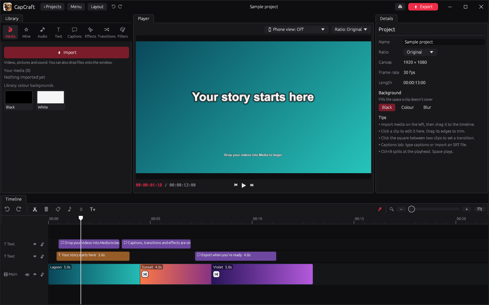
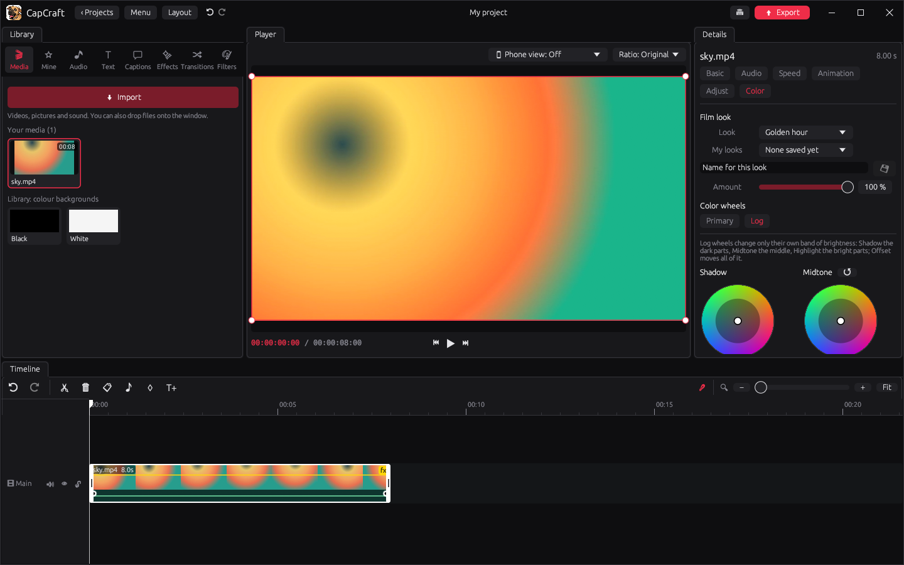
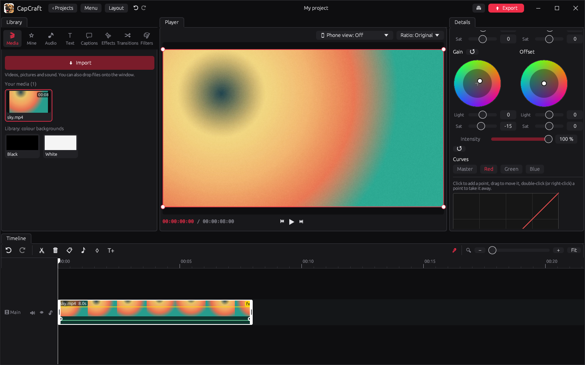
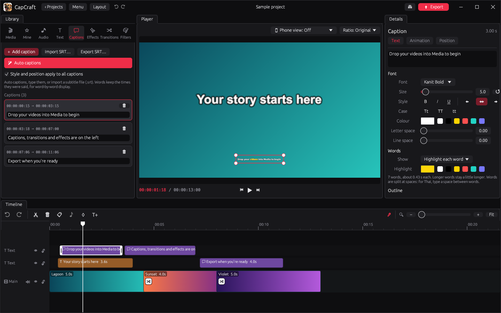
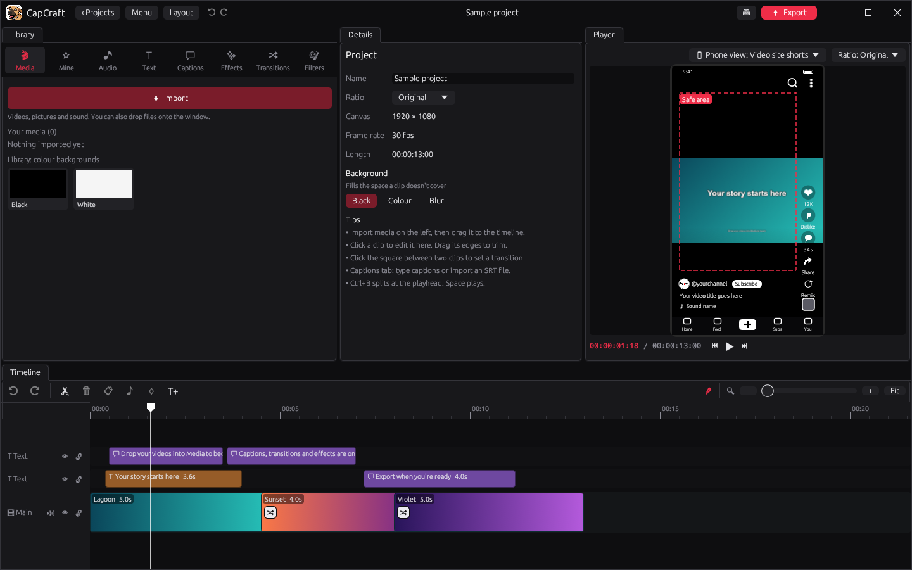

# CapCraft

**A fast, friendly desktop video editor for Windows, written in Rust.**

CapCraft is a timeline video editor for short videos, vlogs and social clips. It has a magnetic
timeline, text and auto captions (with proper Thai support), transitions, effects, colour grading
with wheels and curves, and MP4 export through FFmpeg. It runs on your own computer: no account,
no upload and no internet needed.



---

## Contents

- [Features](#features)
- [Screenshots](#screenshots)
- [Getting started](#getting-started)
- [Keyboard shortcuts](#keyboard-shortcuts)
- [Building from source](#building-from-source)
- [Where your files go](#where-your-files-go)
- [Project layout](#project-layout)
- [Credits and licence](#credits-and-licence)

---

## Features

### Editing
- **Projects screen** with covers, autosave and recent projects.
- **Magnetic main track**: clips close up gaps on their own. Extra video, text and sound tracks sit above and below it.
- **Split, trim, move, duplicate and delete**, with snapping to clip edges and the playhead.
- **Multi-select**: pick several clips and move or delete them together.
- **Undo and redo** for every change.
- **Image duration and big step** settings: how long pictures last when added (seconds or frames), and how far Shift + arrow moves the playhead.
- **Timeline zoom** with the slider, Ctrl + mouse wheel, or Ctrl + plus/minus.
- **Movable panels**: drag the panels into your own layout, save layouts by name and switch between them.

### Video
- **Position, scale, rotation, opacity and flip** for every clip, with **keyframes** to animate them.
- **Speed** from slow motion to fast, with the pitch of the voice kept (up to 5×).
- **Transitions** between clips (mix, slides, wipes, zooms and more) and **in/out animations**.
- **Filters and effects** with live previews, plus an **Adjust** panel (brightness, contrast, saturation, temperature and more).
- **Canvas ratios** (16:9, 9:16, 1:1, 4:3, 3:4, 21:9) with a black, colour or blurred background.

### Colour grading
- **Primary and Log colour wheels** (Lift, Gamma, Gain, Offset), each with its own light and saturation, and an intensity for each set of wheels.
- **Curves** for Master, Red, Green and Blue.
- **Film looks** (warm print, teal & orange, bleach bypass, noir, golden hour…) with an amount slider.
- **My looks**: save a grade under your own name and use it again in any project. The built-in looks can't be overwritten.

### Text and captions
- **Text clips** with fonts, size, bold/italic/underline, alignment, letter case, colours, outline, shadow and background.
- **Captions track**: type captions, or **import and export SRT** subtitle files.
- **Auto captions**: the speech in your video becomes captions, worked out on your own computer (optional speech engine, see below). Thai and many other languages.
- **Word by word**: show one word at a time, build the line word by word, or highlight each word as it is said.
- **Thai shaping**: vowels and tone marks are placed correctly, both in the editor and in the exported video.

### Sound
- Volume per clip, **fade in and out**, **volume lines** with points you can drag, and mute per track.
- Sound plays in the player while you edit. If Windows has muted CapCraft in its Volume Mixer, the player says so and turns the sound back on with one click.

### Phone view
- Check your framing for vertical video: the player can show a short-video phone screen on top of your video, with your channel name and picture and the **safe area** outlined.

### Export
- **MP4** at 480p, 720p, 1080p, 2K or 4K, with Lower, Recommended or Higher quality and a choice of frame rate.
- **Custom bitrate**: type your own bitrate in kbps (from 1000 up to a limit for each resolution, e.g. 50 000 at 1080p), variable (VBR) or constant (CBR).

---

## Screenshots

### The editor
The library (media, your own files, audio, text, captions, effects, transitions and filters) is on the
left, the player in the middle, the details of what you picked on the right, and the timeline below.


### Colour wheels and film looks
Pick a film look, fine-tune it with the Primary wheels, and save the result to **My looks** with the save button.


### Log wheels
The Log wheels grade the shadows, midtones and highlights of flat (log) footage.



### Curves
Shape the Master, Red, Green or Blue curve: click to add a point, drag to move it, double-click to take it away.



### Captions, word by word
The Captions tab lists every caption with its times. Each word can be highlighted as it is said.



### Phone view and safe area
See how a vertical video will look in a phone app before you post it.



---

## Getting started

1. Download or build `CapCraft.exe` (see [Building from source](#building-from-source)).
2. Make sure **FFmpeg** is available: put `ffmpeg.exe` and `ffprobe.exe` beside `CapCraft.exe`, or install FFmpeg and add it to your `PATH`.
3. Start CapCraft, click **New project**, and drop your videos, pictures and music onto the window.
4. Drag clips to the timeline, edit, then click **Export** at the top right.

### Optional: auto captions
Auto captions use [whisper.cpp](https://github.com/ggerganov/whisper.cpp). Put `whisper-cli.exe` in a
`whisper` folder beside `CapCraft.exe`, the Thai model in `whisper/models` and a general (multilingual)
model in `whisper/models-general`. In **Menu → Settings** choose whether it runs on the graphics card
(CUDA, fast, NVIDIA only) or the processor.

---

## Keyboard shortcuts

| Keys | Action |
| --- | --- |
| Space | Play / pause |
| Ctrl + B | Split at the playhead |
| Delete or Backspace | Delete the selected clips |
| Ctrl + Z | Undo |
| Ctrl + Shift + Z or Ctrl + Y | Redo |
| Ctrl + D | Duplicate |
| Ctrl + A | Select all |
| Esc | Select nothing |
| ← / → | One frame back / forward |
| Shift + ← / → | Big step back / forward (10 frames; change it in Settings) |
| Home / End | Go to the start / end |
| K | Add or remove a keyframe |
| T | Add a text at the playhead |
| Ctrl + I | Import media |
| Ctrl + S | Save the project |
| Ctrl + E | Export |
| Ctrl + plus / Ctrl + minus | Zoom the timeline in / out |
| Ctrl + mouse wheel | Zoom the timeline |

---

## Building from source

CapCraft is a Rust program using [egui / eframe](https://github.com/emilk/egui).

1. Install [Rust](https://rustup.rs). The project pins the `stable-x86_64-pc-windows-gnu` toolchain in `rust-toolchain.toml`; rustup installs it for you.
2. Clone the repository and build:

   ```sh
   git clone https://github.com/bozodesign/CapCraft.git
   cd CapCraft
   cargo build --release
   ```

3. The program is `target/release/CapCraft.exe`. Put `ffmpeg.exe` and `ffprobe.exe` beside it.

If the computer has no Windows SDK, the GNU toolchain needs GNU `dlltool`. Point Cargo at it in
`.cargo/config.toml`:

```toml
[target.x86_64-pc-windows-gnu]
rustflags = ["-C", "dlltool=C:/path/to/dlltool.exe"]
```

Run the tests with `cargo test`.

### Making a zip to share

```powershell
powershell -ExecutionPolicy Bypass -File tools\make-portable.ps1                # the app (about 75 MB)
powershell -ExecutionPolicy Bypass -File tools\make-portable.ps1 -WithCaptions  # also the auto-captions pack
```

This builds the release program and writes `dist\CapCraft-<version>-windows.zip`: `CapCraft.exe`,
`ffmpeg.exe`, `ffprobe.exe` (taken from `C:\ffmpeg`, or `-FFmpegDir`), a read-me and the licences.
Whoever gets it unzips it and double-clicks `CapCraft.exe`; nothing needs installing, because the program
only uses files that come with Windows. `-WithCaptions` also writes `dist\CapCraft-<version>-auto-captions.zip`
with the `whisper` folder (about 2 GB), which goes beside `CapCraft.exe`.

---

## Where your files go

| What | Where |
| --- | --- |
| Projects (`.cutproj`) and their covers | `Documents\CapCraft Projects` |
| Settings, saved layouts and My looks | `%APPDATA%\CapCraft` |

Your media files stay where they are; projects only point to them.

---

## Project layout

| File | What it does |
| --- | --- |
| `src/main.rs` | Start-up and command-line options |
| `src/app.rs` | The main window, panels, playback and shortcuts |
| `src/timeline.rs` | The timeline: tracks, clips, snapping, zoom |
| `src/details.rs` | The Details panel: clip, text, audio, speed and colour settings |
| `src/library.rs` | The Library panel: media, text, effects, transitions, filters |
| `src/model.rs` | The project: tracks, clips, effects, grades |
| `src/render.rs` | Drawing frames: transforms, effects, colour grading |
| `src/decode.rs`, `src/media.rs` | Reading video, pictures and sound with FFmpeg |
| `src/audio.rs`, `src/winsound.rs` | Sound playback and the Windows Volume Mixer check |
| `src/export.rs` | Exporting to MP4 |
| `src/speech.rs`, `src/srt.rs` | Auto captions and SRT files |
| `src/thai.rs` | Thai text shaping |
| `src/looks.rs` | Saved colour looks |
| `src/home.rs`, `src/projects.rs` | The projects screen and where files are kept |
| `src/layout.rs`, `src/theme.rs` | Panel layouts and the dark theme |

---

## Credits and licence

CapCraft uses the Kanit font (SIL Open Font License 1.1), egui, egui_dock, rustybuzz and other open-source
libraries. See [CREDITS.md](CREDITS.md) for the full list.

CapCraft's own code is released under the [MIT License](LICENSE).
